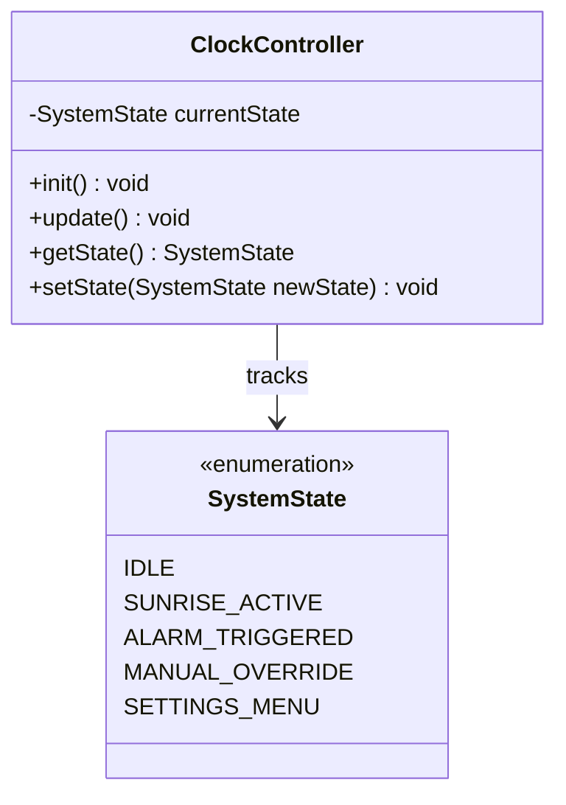

# Sunrise Alarm Clock - Software Architecture & Plan

## 1. Architectural Overview
The Sunrise Alarm Clock firmware follows an event-driven, non-blocking modular architecture. 
A central coordinator manages high-level system states and orchestrates dedicated subsystem drivers, ensuring responsive user input, reliable timekeeping, and smooth real-time dimming.

---

## 2. Architecture Roadmap (Incremental Plan)
We are building out the architecture incrementally, adding and reviewing one subsystem at a time:

- [x] **Step 1: Core Coordinator (`ClockController`) & System States** *(Current step)*
- [ ] **Step 2: Timekeeping Subsystem (`TimeManager` / DS3231 RTC)**
- [ ] **Step 3: User Input Subsystem (`InputManager` / Encoders & Switches)**
- [ ] **Step 4: Display Subsystem (`DisplayManager` / TM1637)**
- [ ] **Step 5: Lighting Subsystem (`LightController` / TRIAC Dimming & DimTone Curve)**
- [ ] **Step 6: Alarm & Actuators (`AlarmManager`, `AudioController`, `BellActuator`)**
- [ ] **Step 7: State Machine & Event Dispatching**

---

## 3. Class Diagram

---

### Step 1 Detail: `ClockController`
* **Role:** The primary application orchestrator called by Arduino's `setup()` and `loop()`.
* **Responsibilities:**
  * Coordinates initialization of all downstream managers.
  * Drives the main non-blocking polling loop (`update()`).
  * Maintains the top-level operational state (`SystemState`) to arbitrate between automated sunrise, physical hammer alarm, manual lighting override, and idle timekeeping.

