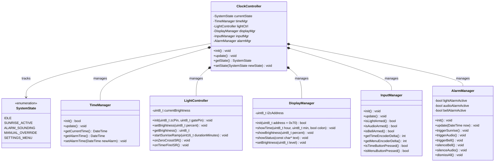

# Sunrise Alarm Clock - Software Architecture & Hardware Specification

## 1. Architectural Overview
The Sunrise Alarm Clock firmware follows an event-driven, non-blocking modular architecture designed specifically for the dual-core ESP32. 

Low-level hardware concerns are encapsulated into six dedicated subsystem managers. A central coordinator arbitrates the high-level system states, while time-critical AC zero-crossing operations are decoupled from standard I/O to guarantee zero light flicker.

---

## 2. Top-Level Class Diagram



---

## 3. Subsystem Breakdown & Physical UX Flow

| Subsystem | Managed Hardware | Physical UX & Operational Logic |
| :--- | :--- | :--- |
| **`ClockController`** | ESP32 Core | Orchestrates the system state machine (`IDLE`, `SUNRISE_ACTIVE`, `ALARM_SOUNDING`, `MANUAL_OVERRIDE`, `SETTINGS_MENU`). Polls all subsystems non-blockingly. |
| **`TimeManager`** | DS3231 RTC Module (I2C: `0x68`) | Battery-backed high-precision timekeeping independent of mains/Wi-Fi (FR-05). Calculates sunrise start time ($T-45\text{m}$). |
| **`LightController`** | RobotDyn TRIAC Dimmer + Philips DimTone LED | Zero-crossing phase-cut dimming. Executes the non-linear 45-minute sunrise curve. Supports manual knob dimming with **bumpless transfer** (NFR-02). |
| **`DisplayManager`** | **Adafruit 1.2" 4-Digit 7-Segment (HT16K33 I2C: `0x70`)** | High-visibility 1.2" (30.5mm) red digits readable across a bedroom. Displays `HH:MM` with hardware colon blinking, settings menus, and 16 dimming levels (`0` to `15`) for dark bedroom comfort. |
| **`InputManager`** | 2× Encoders + 3× Toggle Switches | **Independent Feature Arming:**<br>• **Switch 1:** Light Sunrise Sequence Arm/Disarm<br>• **Switch 2:** Audio Chimes Arm/Disarm<br>• **Switch 3:** Mechanical Bell Arm/Disarm<br>• **Knob 1 Button:** Manual reading light toggle / Time adjust<br>• **Knob 2 Button:** Menu navigate / Setting confirm |
| **`AlarmManager`** | DFPlayer Mini (UART) + Twin-Bell Motor (MOSFET) | **Tactile Silence Logic:** Flipping Switch 3 DOWN while ringing silences the active bell alarm; flipping it back UP arms it for tomorrow's alarm without re-triggering today.<br>Flipping Switch 1 DOWN disarms future light alarms without abruptly cutting the light if already on. |

---

## 4. Dual-Core Execution & Anti-Flicker Model

To satisfy **NFR-01 (Zero Acoustic Buzzing & Zero Flicker)**, phase-angle timing is protected from microsecond timing jitter:

```mermaid
flowchart TD
    subgraph ESP32["ESP32 Dual-Core Architecture"]
        subgraph Core0["Core 0 (Background / Async Tasks)"]
            Net["Network / Wi-Fi Stack (FreeRTOS)"]
            Web["Web Configuration Server (Optional)"]
            NTP["NTP Time Sync Client"]
        end

        subgraph Core1["Core 1 (Application & Real-Time Engine)"]
            ISR_ZC["Zero-Cross Hardware ISR (GPIO 36)"]
            TimerISR["ESP32 Hardware Timer ISR (GPIO 26 Gate Pulse)"]
            
            subgraph Loop["Main Arduino loop()"]
                CC["ClockController::update()"]
                IM["InputManager::update()"]
                TM["TimeManager::update()"]
                AM["AlarmManager::update()"]
                DM["DisplayManager::update()"]
            end
        end
    end

    ISR_ZC -->|Starts 64-bit Timer Delay| TimerISR
    TimerISR -->|Fires Gate Pulse (20-50us)| TRIAC["RobotDyn Dimmer"]
    Loop -.->|Sets Phase Angle Delay| TimerISR
```

---

## 5. Master Hardware Pinout & Electrical Rails

> [!IMPORTANT]
> **Power Rail Distribution:** 
> * **3.3V Rail:** Low-power logic only (Switches, Encoder pull-ups, Dimmer logic, RTC).
> * **5V Rail (Mean Well 30W):** High-power actuators, audio, and display (DFPlayer Mini, Twin-Bell Motor, Adafruit 1.2" Display, Qi Wireless Charger). This places **0mA load** on the ESP32 3.3V regulator for the display and external modules!
> * **I2C Bus Sharing:** Both the DS3231 RTC (`0x68`) and the Adafruit 1.2" Display (`0x70`) share the hardware I2C bus on `GPIO 21` (SDA) and `GPIO 22` (SCL). `GPIO 18` and `GPIO 19` are freed as spare expansion pins.

| Component | Pin Function | ESP32 GPIO | Direction | Power Rail | Electrical Wiring & Protection Notes |
| :--- | :--- | :--- | :--- | :--- | :--- |
| **DS3231 RTC** | SDA | `GPIO 21` | In/Out | **3.3V** | Shared I2C Bus (`0x68`). |
| **DS3231 RTC** | SCL | `GPIO 22` | Output | **3.3V** | Shared I2C Bus (`0x68`). |
| **Adafruit 1.2" Display**| SDA | `GPIO 21` | In/Out | **5V (Power)** | Shared I2C Bus (`0x70`). Powered from 5V rail; 3.3V I/O compatible. |
| **Adafruit 1.2" Display**| SCL | `GPIO 22` | Input | **5V (Power)** | Shared I2C Bus (`0x70`). Powered from 5V rail; 3.3V I/O compatible. |
| **RobotDyn Dimmer** | Zero-Cross (Z-C) | `GPIO 36` (VP) | Input (ISR) | **3.3V (Logic)**| Input-only pin. Pull-up is powered from 3.3V rail. |
| **RobotDyn Dimmer** | Gate / PWM | `GPIO 26` | Output | 3.3V Logic | Drives MOC3021 optoisolator LED (20–50 µs pulse). |
| **Toggle Switch 1** | Light Arm/Disarm | `GPIO 34` | Input | **3.3V High-Side** | Input-only. External 10kΩ pull-down to GND. |
| **Toggle Switch 2** | Audio Arm/Disarm | `GPIO 35` | Input | **3.3V High-Side** | Input-only. External 10kΩ pull-down to GND. |
| **Toggle Switch 3** | Bell Arm/Disarm | `GPIO 39` (VN) | Input | **3.3V High-Side** | Input-only. External 10kΩ pull-down to GND. |
| **Rotary Enc 1 (Time)**| CLK | `GPIO 25` | Input (ISR) | **3.3V (VCC)** | KY-040 onboard 10kΩ pull-ups powered from 3.3V. |
| **Rotary Enc 1 (Time)**| DT | `GPIO 32` | Input (ISR) | **3.3V (VCC)** | KY-040 onboard 10kΩ pull-ups powered from 3.3V. |
| **Rotary Enc 1 (Time)**| SW (Button) | `GPIO 33` | Input | 3.3V Logic | Internal `INPUT_PULLUP` enabled in firmware. |
| **Rotary Enc 2 (Menu)**| CLK | `GPIO 4` | Input (ISR) | **3.3V (VCC)** | KY-040 onboard 10kΩ pull-ups powered from 3.3V. |
| **Rotary Enc 2 (Menu)**| DT | `GPIO 13` | Input (ISR) | **3.3V (VCC)** | KY-040 onboard 10kΩ pull-ups powered from 3.3V. |
| **Rotary Enc 2 (Menu)**| SW (Button) | `GPIO 23` | Input | 3.3V Logic | Internal `INPUT_PULLUP` enabled in firmware. |
| **DFPlayer Mini** | RX | `GPIO 17` (TX2) | Output | **5V (Power)** | **MUST include 1kΩ series resistor** (`R1`) from GPIO 17. |
| **DFPlayer Mini** | TX | `GPIO 16` (RX2) | Input | **5V (Power)** | Direct 3.3V logic return. |
| **Twin-Bell Motor** | MOSFET Gate | `GPIO 27` | Output (PWM) | **5V (Motor Rail)**| IRLZ44N gate drive: 330Ω series (`R3`) + 10kΩ pull-down (`R2`). |
| *Spare / Expansion* | Reserved | `GPIO 18` | Spare | N/A | Previously TM1637 CLK (Now free!). |
| *Spare / Expansion* | Reserved | `GPIO 19` | Spare | N/A | Previously TM1637 DIO (Now free!). |

---

## 6. Critical Hardware Safety & Circuit Specifications

### 1. I2C Bus Architecture:
* The **Adafruit 1.2" 4-Digit 7-Segment Display** (HT16K33 driver, default address **`0x70`**) and the **DS3231 RTC** (address **`0x68`**) share the hardware I2C bus (`GPIO 21` SDA, `GPIO 22` SCL).
* **Power Isolation:** The Adafruit display is powered from the **5V power bus** (drawing up to 150mA from the 30W Mean Well SMPS), completely eliminating current/thermal stress on the ESP32’s 3.3V LDO regulator.
* **Spare GPIOs:** `GPIO 18` and `GPIO 19` are completely freed for future enhancements (e.g. ambient light LDR sensor, snooze button, or addressable status LEDs).

### 2. ZS-042 Battery Charging Disconnect:
* The 200Ω SMD resistor labeled **`201`** (or adjacent diode) on the ZS-042 board must be **desoldered / snipped** to safely use standard **CR2032** primary batteries.
* If using the Raspberry Pi Mini DS3231 board with 5-pin female socket, a CR1220/CR927 coin cell or external 3V battery leads are soldered to the board's battery pads.

### 3. Bell Motor Protection & Ringing Cadence:
* **PWM Chopping:** ESP32 `GPIO 27` PWM duty cycle restricted to **~30%–35%** (effective ~1.5V–1.7V from the 5V bus).
* **Thermal Protection:** Fast **1N5819 Schottky flyback diode** across motor terminals + **500mA PTC resettable polyfuse** (`F1`) in series with the motor coil.
* **Firmware Cadence:** **10 seconds ringing $\rightarrow$ 2.5 seconds pause $\rightarrow$ repeat up to 5 minutes maximum timeout**.

### 4. Qi Wireless Phone Charger Protection & Star Topology:
* **Star-Power Isolation:** The wireless charger connector (`J13`) is situated immediately adjacent to `J1` (5V Main Power In). Heavy inductive current ($1.0\text{ A} - 1.5\text{ A}$) loops strictly in the bottom-right corner without traversing the motherboard or entering sensitive audio/MCU grounds.
* **Overcurrent Protection:** In-line **1.5A–2.0A PTC Resettable Polyfuse** (`F2`) prevents phone dock coil faults from browning out the alarm clock.
* **Transient Decoupling:** Filter capacitor (`C2`) absorbs $110\text{ kHz} - 205\text{ kHz}$ primary coil switching hash.

### 5. Audio Decoupling:
* **Localized Bulk Decoupling:** A **470 µF / 16V low-ESR electrolytic capacitor** (`C1`) is placed directly adjacent to `J5` (DFPlayer Mini VCC & GND) to absorb 3W audio current transients and eliminate speaker buzz/hum.

---

## 7. Power Budget & Sizing Analysis

The system is powered by the **Mean Well IRM-30-5ST (30W, 5V @ 6.0A continuous)** enclosed switching power supply with screw terminals:

| Subsystem / Load | Typical Current | Peak Current | Sourced Rail |
| :--- | :--- | :--- | :--- |
| **ESP32 DevKit** (CPU + Wi-Fi TX burst) | 120 mA | 500 mA | 5V Rail (Internal 3.3V LDO) |
| **DFPlayer Mini + 3W 4Ω Speaker** | 150 mA | 1,000 mA | 5V Rail (Decoupled by `C1`) |
| **1.5V Bell Clapper Motor** (PWM Chopped) | 350 mA | 1,200 mA | 5V Rail (Protected by `F1` & `D1`) |
| **Adafruit 1.2" HT16K33 7-Segment** | 40 mA | 150 mA | 5V Rail |
| **Qi Wireless Phone Charger Dock** | 0 mA (Idle) | 1,200 mA | 5V Rail (Protected by `F2` & `C2`) |
| **Low-Power Logic** (RTC, Dimmer Optos, Encoders) | 20 mA | 50 mA | 3.3V Rail (from ESP32 LDO) |
| **TOTAL WORST-CASE SIMULTANEOUS LOAD** | **~680 mA** | **~4,100 mA (4.1A)** | **5V Bus** |

> [!NOTE]
> **Power Margin:** Under total simultaneous worst-case operation (Wi-Fi syncing + audio chime blasting + bell clapper ringing + phone fast-charging on dock), the total current draw is $\approx 4.1\text{ A}$, which is **68% of the power supply's 6.0A continuous capacity**. This guarantees a **>30% safety margin** and eliminates any risk of brownout resets.

---

## 8. Motherboard Physical Specifications & Master BOM

### PCB Mechanical Specifications:
* **Dimensions:** $114.30\text{ mm} \times 73.66\text{ mm}$ ($4.500" \times 2.900"$)
* **Mounting:** 4× M3 ($3.2\text{ mm}$ diameter) mounting holes located at the 4 corners ($4.0\text{ mm}$ edge inset).
* **Layer Stack:** 2-Layer FR4 ($1.6\text{ mm}$ thickness, 1 oz copper).
* **Routing Architecture:** Point-to-point manually hand-routed dual-layer board across Top Layer (`F.Cu`) and Bottom Layer (`B.Cu`).
* **Grounding Topology:** Discrete point-to-point manual ground return traces connecting each ground pad. **Zero filled copper zones / no solid copper pour**.
* **Vias:** **Exactly 8 vias** (0.60 mm pad diameter, 0.30 mm drill hole) bridging tracks between `F.Cu` and `B.Cu`:
  1. `+5V` Power Via at (113.67 mm, 87.63 mm)
  2. `GND` Return Via at (58.42 mm, 58.42 mm)
  3. `GPIO_21` (I2C SDA) Via at (96.52 mm, 50.80 mm)
  4. `GPIO_16` (DFPlayer TX) Via at (60.57 mm, 35.17 mm)
  5. `GPIO_17` (DFPlayer RX) Via at (63.50 mm, 63.50 mm)
  6. `GPIO_32` (Encoder 1 DT) Via at (106.68 mm, 83.82 mm)
  7. `GPIO_27` (MOSFET Gate) Via at (86.78 mm, 58.84 mm)
  8. `GPIO_27` (MOSFET Gate) Via at (114.30 mm, 48.26 mm)
* **Track Widths:** Multi-tiered trace routing:
  * **1.20 mm Power & Ground Traces:** High-current paths for Twin-Bell Motor (`Net-(D1-K)`, `Net-(D1-A)`, `Q1` Source GND), Qi Wireless Charger (`Net-(J13-Pin_2)`, `J13` GND), and the main `+5V` / `GND` distribution trunks.
  * **0.60 mm Decoupling Return:** Audio decoupling capacitor `C1` ground return link into the main ground trunk.
  * **0.20 mm Signal & Logic Traces:** All standard 3.3V/5V logic, I2C, UART, switch sensing, and spare GPIO lines.

---

### Master Bill of Materials (BOM) & Footprint Manifest (28 Components + Mounting Holes):

| Ref | Value / Label | Functional Role | Exact KiCad Footprint | Physical Part / Connector Type |
| :--- | :--- | :--- | :--- | :--- |
| **J1** | `5V Power In` | Main DC Input from Mean Well PSU | `TerminalBlock_Phoenix:TerminalBlock_Phoenix_MKDS-1,5-2_1x02_P5.00mm_Horizontal` | 2-pin 5.00mm Screw Terminal |
| **J2** | `J_ESP_Left` | ESP32 DevKit V1 (Pins 1–19) | `Connector_PinSocket_2.54mm:PinSocket_1x19_P2.54mm_Vertical` | 19-pin 2.54mm Female Socket |
| **J3** | `J_ESP_Right` | ESP32 DevKit V1 (Pins 20–38) | `Connector_PinSocket_2.54mm:PinSocket_1x19_P2.54mm_Vertical` | 19-pin 2.54mm Female Socket ($25.40\text{mm}$ row spacing) |
| **J4** | `DS3231_Mini` | Real-Time Clock Module | `Connector_PinHeader_2.54mm:PinHeader_1x05_P2.54mm_Vertical` | 5-pin 2.54mm Male Pin Header |
| **J5** | `J_DF_Left` | DFPlayer Mini (Pins 1–8) | `Connector_PinSocket_2.54mm:PinSocket_1x08_P2.54mm_Vertical` | 8-pin 2.54mm Female Socket |
| **J6** | `J_DF_Right` | DFPlayer Mini (Pins 9–16) | `Connector_PinSocket_2.54mm:PinSocket_1x08_P2.54mm_Vertical` | 8-pin 2.54mm Female Socket ($15.24\text{mm}$ row spacing) |
| **J7** | `J_SPEAKER` | 3W Speaker Audio Output | `Connector_PinHeader_2.54mm:PinHeader_1x02_P2.54mm_Vertical` | 2-pin 2.54mm Male Pin Header |
| **J8** | `J_OUT_TO_TRIAC_DIMMER` | AC Dimmer Module Connection | `Connector_PinHeader_2.54mm:PinHeader_1x04_P2.54mm_Vertical` | 4-pin 2.54mm Male Pin Header |
| **J9** | `J_Display` | HT16K33 7-Segment Display | `Connector_PinHeader_2.54mm:PinHeader_1x05_P2.54mm_Vertical` | 5-pin 2.54mm Male Pin Header |
| **J10** | `J_OutToMotor` | 1.5V Bell Clapper Motor Output | `TerminalBlock_Phoenix:TerminalBlock_Phoenix_MKDS-1,5-2_1x02_P5.00mm_Horizontal` | 2-pin 5.00mm Screw Terminal |
| **J11** | `J_ToRotaryEncoder1` | Rotary Encoder 1 (Time Adjust) | `Connector_PinHeader_2.54mm:PinHeader_1x05_P2.54mm_Vertical` | 5-pin 2.54mm Male Pin Header |
| **J12** | `J_ToRotaryEncoder2` | Rotary Encoder 2 (Menu Navigate) | `Connector_PinHeader_2.54mm:PinHeader_1x05_P2.54mm_Vertical` | 5-pin 2.54mm Male Pin Header |
| **J13** | `J_ToWirelessCharger`| Qi Wireless Charging Dock Output | `TerminalBlock_Phoenix:TerminalBlock_Phoenix_MKDS-1,5-2_1x02_P5.00mm_Horizontal` | 2-pin 5.00mm Screw Terminal |
| **J14** | `J_ToSwitch1` | Toggle Switch 1 (Light Arm) | `Connector_PinHeader_2.54mm:PinHeader_1x02_P2.54mm_Vertical` | 2-pin 2.54mm Male Pin Header |
| **J15** | `J_ToSwitch2` | Toggle Switch 2 (Audio Arm) | `Connector_PinHeader_2.54mm:PinHeader_1x02_P2.54mm_Vertical` | 2-pin 2.54mm Male Pin Header |
| **J16** | `J_ToSwitch3` | Toggle Switch 3 (Bell Arm) | `Connector_PinHeader_2.54mm:PinHeader_1x02_P2.54mm_Vertical` | 2-pin 2.54mm Male Pin Header |
| **Q1** | `IRLZ44N` | Logic-Level N-MOSFET (Motor Driver) | `Package_TO_SOT_THT:TO-220-3_Vertical` | TO-220 Through-Hole |
| **D1** | `1N5819` | Schottky Flyback Diode (across motor) | `Diode_THT:D_DO-41_SOD81_P7.62mm_Horizontal` | DO-41 Axial Diode (7.62mm pitch) |
| **F1** | `500mA PTC` | Motor Short & Runaway Polyfuse | `Fuse:Fuse_Bourns_MF-RG500` | Radial PTC Disc (5.1mm pitch) |
| **F2** | `1.5A/2A PTC` | Wireless Charger Overcurrent Polyfuse | `Fuse:Fuse_Bourns_MF-RG500` | Radial PTC Disc (5.1mm pitch) |
| **C1** | `470 uF` | Audio 5V Bulk Decoupling Capacitor | `Capacitor_THT:CP_Radial_D8.0mm_P3.80mm` | Radial Electrolytic Can (8mm dia) |
| **C2** | `100nF` | Wireless Charger Switching Filter | `Capacitor_THT:C_Disc_D4.7mm_W2.5mm_P5.00mm` | 100nF Ceramic Disc Capacitor |
| **R1** | `1Kohm` | DFPlayer RX Series Resistor | `Resistor_THT:R_Axial_DIN0207_L6.3mm_D2.5mm_P7.62mm_Horizontal` | 1/4W Axial Resistor (7.62mm pitch) |
| **R2** | `10Kohm` | MOSFET Gate Pull-Down (to GND) | `Resistor_THT:R_Axial_DIN0207_L6.3mm_D2.5mm_P7.62mm_Horizontal` | 1/4W Axial Resistor (7.62mm pitch) |
| **R3** | `330ohm` | MOSFET Series Gate Resistor | `Resistor_THT:R_Axial_DIN0207_L6.3mm_D2.5mm_P7.62mm_Horizontal` | 1/4W Axial Resistor (7.62mm pitch) |
| **R4** | `10Kohm` | Switch 1 Pull-Down (GPIO 34 to GND) | `Resistor_THT:R_Axial_DIN0207_L6.3mm_D2.5mm_P7.62mm_Horizontal` | 1/4W Axial Resistor (7.62mm pitch) |
| **R5** | `10Kohm` | Switch 2 Pull-Down (GPIO 35 to GND) | `Resistor_THT:R_Axial_DIN0207_L6.3mm_D2.5mm_P7.62mm_Horizontal` | 1/4W Axial Resistor (7.62mm pitch) |
| **R6** | `10Kohm` | Switch 3 Pull-Down (GPIO 39 to GND) | `Resistor_THT:R_Axial_DIN0207_L6.3mm_D2.5mm_P7.62mm_Horizontal` | 1/4W Axial Resistor (7.62mm pitch) |
| **M3** | `MountingHoles`| 4 Corner Mechanical Standoffs | `MountingHole:MountingHole_3.2mm_M3` | 4× M3 Mechanical Mounting Holes |

---

## 9. Cabling & Enclosure Interconnect Standard

* **Panel-Mount Female Ribbon Cables (DuPont):**
  * Display (`J9`): 5-pin female cable to Adafruit HT16K33 board.
  * AC Dimmer (`J8`): 4-pin female cable to RobotDyn module.
  * Rotary Encoders (`J11`, `J12`): 5-pin female cables to KY-040 boards.
  * Toggle Switches (`J14`, `J15`, `J16`): 2-pin female cables soldered to SPST toggle switch lugs.
  * Speaker (`J7`): 2-pin female cable to 3W speaker.
* **Heavy-Gauge Screw Terminal Wiring (18–22 AWG Stranded):**
  * `J1`: 5V Input from Mean Well IRM-30-5ST output terminals.
  * `J10`: Motor wires directly to physical twin-bell clapper mechanism.
  * `J13`: Power leads to Qi wireless charging transmitter coil under top case lid.
